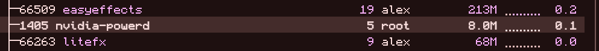

<div align="center">
  
  <h1>litefx</h1>
  <p><strong>A lightweight alternative to EasyEffects and other audio processing nerd stuff.</strong></p>
  <p>A square, clean audio processing tool for Linux written in C/C++ (GTK3 + PipeWire + Zita-Convolver).<br/>Made for minimal system use and maximum efficiency.</p>
</div>

---

## ⚡ Resource Comparison: EasyEffects vs. LiteFX

Monolithic audio suites keep a massive GUI toolkit resident in memory at all times (`200+ MB RAM`). **LiteFX** uses a decoupled architecture:
- Even with the full **LiteFX GUI window open**, it uses **`~3x` less memory** than EasyEffects (`68 MB` vs `213 MB`) and **`0.0%` idle CPU**:

<div align="center">
  
</div>

- And when you **close the LiteFX GUI window**, 100% of the GUI memory is freed (**`0 MB`**), while the background PipeWire DSP daemon (`litefxd`) keeps processing your audio using only **`~2.5 – 10 MB RAM`** and **`< 0.2% CPU`**.

| Metric | EasyEffects | LiteFX (`litefxd` + `litefx`) |
| :--- | :--- | :--- |
| **GUI Open RAM** | `~213 MB` | **`~68 MB`** |
| **Background DSP RAM (GUI Closed)** | `~160–213 MB` | **`~2.5 – 10 MB`** (`0 MB` GUI) |
| **Startup Time** | `~1.5 – 3.0 s` | **`< 40 ms`** |
| **13-Band Linear-Phase FIR Crystalizer** | Yes (`zita-convolver`) | **Yes (`zita-convolver`, identical math)** |
| **Parametric EQ + Split L/R + AutoEQ** | Yes | **Yes** |
| **Dedicated Mic DSP Pipeline** | Yes | **Yes (Gate + Denoiser + Compressor + EQ)** |

---

## 📦 Packages & Installation

Pre-built packages are available on the [**GitHub Releases**](https://github.com/webpukkie/litefx/releases/latest) page, or you can install directly using your distribution's package manager:

### 1. Arch Linux (`.pkg.tar.zst` / `PKGBUILD`)
Download `litefx-0.3.0-1-x86_64.pkg.tar.zst` from [**Releases**](https://github.com/webpukkie/litefx/releases/latest) and install:
```bash
sudo pacman -U litefx-0.3.0-1-x86_64.pkg.tar.zst
```
Or build directly from `packaging/arch/PKGBUILD`:
```bash
git clone https://github.com/webpukkie/litefx.git
cd litefx/packaging/arch
makepkg -si
```

### 2. Debian / Ubuntu / Mint (`.deb` Package)
Download `litefx_0.3.0_amd64.deb` from [**Releases**](https://github.com/webpukkie/litefx/releases/latest) and install:
```bash
sudo apt install ./litefx_0.3.0_amd64.deb
```

### 3. NixOS / Nix Flakes (`flake.nix`)
Run or install directly from the flake:
```bash
nix run github:webpukkie/litefx
# or install to your profile:
nix profile install github:webpukkie/litefx
```

### 4. Portable Linux Archive (`.tar.gz`) / Build from Source
#### Dependencies:
- **Arch Linux:** `sudo pacman -S base-devel pipewire gtk3 zita-convolver`
- **Ubuntu / Debian:** `sudo apt install build-essential pkg-config libpipewire-0.3-dev libgtk-3-dev libzita-convolver-dev`
- **Fedora:** `sudo dnf install gcc gcc-c++ make pkgconf-pkg-config pipewire-devel gtk3-devel zita-convolver-devel`

#### Compile & Install:
```bash
git clone https://github.com/webpukkie/litefx.git
cd litefx
make test
make install-user   # Installs to ~/.local/bin + creates Desktop shortcut & systemd user service
# OR system-wide:
sudo make PREFIX=/usr install
```

---

## 📖 How to Use LiteFX

### 1. Launching the Studio
- Launch **LiteFX** from your application launcher or run:
  ```bash
  litefx             # Opens Speakers / Headphones DSP window (default)
  litefx --mic       # Opens Microphone DSP window
  litefx --both      # Opens both windows simultaneously
  ```
- LiteFX automatically starts `litefxd` in the background if it isn't already running, creates two isolated virtual PipeWire devices (`LiteFX Sink` for speakers/headphones and `LiteFX Mic Source` for microphone), and routes your audio seamlessly.
- Use the **`🎧 Speakers`** and **`🎤 Microphone`** buttons in the top bar to switch between output and input pipelines, or click **`🌐 EN` / `🌐 UA`** to switch the interface language between English and Ukrainian.

### 2. Equalizer, Split L/R & Built-in Headphone AutoEQ Search
- **Interactive Bode Plot:** Drag square band nodes `[1..10]` directly on the graph to adjust Frequency (`20 Hz – 20 kHz`) and Gain (`-24 dB .. +24 dB`). Use the **mouse scroll wheel** over any band node to tighten or widen its `Q` factor (`0.1 .. 20.0`), or right-click / double-click a node to reset it to `0.0 dB`.
- **Filter Types:** Select any band and choose between `Peak / Bell`, `Low Shelf`, `High Shelf`, `Low Pass`, `High Pass`, or `Notch`.
- **Numeric Preamp & Auto-Preamp:** Drag the Preamp slider or type an exact dB value into the numeric spinbox next to it. Enable **Auto-Preamp** to automatically prevent digital clipping.
- **Independent Left/Right Channel EQ (`Split L/R`):** Check **`Split L/R`** and choose **`Left`** or **`Right`** from the dropdown to equalize each ear independently (the opposite channel is displayed as a dashed reference curve).
- **Built-in Headphone AutoEQ Search (`🔍 Headphone EQ`):** Click **`🔍 Headphone EQ`** directly on the EQ bar or in the Profiles tab to instantly search through 8,800+ calibrated headphone models (Sony WH-1000XM4/XM5, Sennheiser HD 600/650/560S, Apple AirPods Pro, Beyerdynamic DT 770/990, Audio-Technica ATH-M50x, Moondrop, etc.). Double-click or click **`✓ Apply EQ Curve`** to download and apply the exact parametric filters and preamp in one click—no need to manually search websites or fiddle with file formats.
- **Local File Import:** You can still click **`📁 Import .txt`** to import custom `ParametricEQ.txt` or `GraphicEQ.txt` files from disk.
- **Live FFT Spectrum (`Spectrum`):** Check **`Spectrum`** to display a real-time 64-band logarithmic FFT spectrum analyzer behind the EQ curve. When unchecked or when the GUI window is closed, the FFT analyzer consumes `0%` CPU.

### 3. 13-Band Linear-Phase FIR Crystalizer
- Switch to the **Crystalizer (13-Band)** tab.
- Powered by `zita-convolver`, LiteFX splits audio into 13 exact linear-phase frequency bands (`120 Hz` to `18.0 kHz`) and dynamically expands transients and detail.
- Use quick presets (`EasyEffects`, `Balanced`, `Crisp`, `Punchy`, `Subtle`), toggle **Adaptive Intensity**, or use per-band **`B`** (Bypass) and **`M`** (Mute) buttons.

### 4. Microphone Broadcast Pipeline (`LiteFX Mic Source`)
- Switch to the **`🎤 Microphone`** window:
  - **Gate (`Thresh`):** Silences room background noise when you aren't speaking.
  - **Denoise (`0..100%`):** Adaptive stationary noise floor tracker & sub-rumble high-pass filter that removes fan hum and hiss.
  - **Compressor (`0..100%`):** Smooth broadcast voice compressor & auto-makeup leveler.
  - **8-Band Voice EQ & 13-Band Voice Crystalizer:** Tailor your voice clarity with instant presets (`Vocal`, `Low-Cut`, `Presence`, `Warm`).

### 5. Custom Profiles, Per-Device Auto-Switch & Autostart
- Open the **Profiles & Routing** tab:
  - **Save / Load / Import / Export Profiles:** Type a profile name (e.g., `Music`, `Gaming`, `Headphones`) and click **`💾 Save Profile`**, or use the quick profile selector in the top bar.
  - **Per-Device Auto-Profile (`🔗 Bind Active Profile to Current Device`):** Bind a saved profile to your currently connected headphones, DAC, or speakers. Whenever PipeWire switches to that device (e.g., turning on Bluetooth headphones), `litefxd` automatically loads its bound profile.
  - **Autostart on Login:** Toggle the **🚀 Autostart** switch to enable `litefxd` at login via `systemd --user` and XDG Autostart. Close the GUI window at any time — your audio continues being processed in the background with `0 MB` GUI overhead!
  - **App Blocklist:** Enter comma-separated app names (e.g., `mpv, vlc`) to bypass DSP processing for specific media players.

---

## 🛠 Command-Line Control (`litefxctl`)

Control everything from scripts, window manager keybindings (Hyprland, Sway, i3), or status bars:

```bash
litefxctl status                        # Show daemon RAM (PSS/RSS), active streams, and DSP state
litefxctl toggle                        # Toggle Speakers DSP bypass on/off
litefxctl toggle-mic                    # Toggle Microphone DSP bypass on/off
litefxctl preset list                   # List all saved profiles
litefxctl preset save Gaming            # Save current DSP settings as 'Gaming'
litefxctl preset load Gaming            # Load 'Gaming' profile
litefxctl import-autoeq Parametric.txt  # Import AutoEQ ParametricEQ.txt or GraphicEQ.txt
litefxctl import-easyeffects            # Import active EQ & Crystalizer from EasyEffects
litefxctl reset                         # Reset all DSP settings to factory defaults
litefxctl stop                          # Restore hardware defaults and stop litefxd
```

---


## Discord

discord server for bug reports and regular yapping: https://discord.gg/FkagyCUQSp

## 📄 License

Released under the [MIT License](LICENSE).
